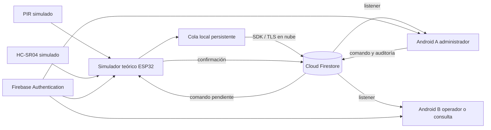
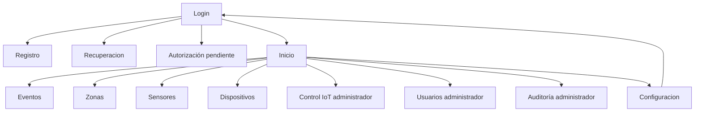

# Arquitectura y decisiones académicas
## Problema y alcance
En el exterior de una plaza, movimiento y proximidad pueden indicar riesgo en pasos de cebra y accesos. ViaTech conserva la finalidad de Amigo Virtual. Sensores simulados producen indicios, nunca multas. El alcance principal es demostrar autenticación, almacenamiento, monitoreo y control seguro de una maqueta.

## Justificación de herramientas
Kotlin y Android Studio cumplen explícitamente Unidad 2, ofrecen tipado, coroutines, depuración e instalación Android. Compose permite una interfaz declarativa accesible; Material 3 aporta controles consistentes. MVVM mantiene consultas y mutaciones fuera de vistas.

Firebase Authentication gestiona credenciales y sesión; Firestore ofrece listeners y autorización de documentos para ambos Android. SQLite es adecuado para persistencia local pero no sincroniza dos teléfonos por sí solo. MySQL requiere API propia, autenticación y mantenimiento de servidor. Firestore reduce esa carga para el prototipo, a cambio de dependencia de red y necesidad de reglas/índices y control de lecturas.

Wi-Fi permite que ambos Android y el ESP32 teórico accedan a Firebase a través de un punto de acceso. Frente a Bluetooth, evita un protocolo directo teléfono-dispositivo y permite sincronización mediante nube. Su consumo suele ser mayor; el alcance y estabilidad dependen de obstáculos, interferencia y router. Bluetooth puede ser útil en proximidad y bajo consumo, pero requeriría un puente hacia Firebase. No se atribuyen metros, latencias o consumo medidos sin experimento.

## Separación
- ui: componentes Compose y estados visuales.
- navegación: Navigation Compose dentro de ui/ViaTechApp.kt, rutas filtradas por perfil.
- viewmodel: StateFlow, trabajos cancelables, límite de espera de operaciones.
- data/models: perfiles, registros, validación.
- data/repositories: autenticación, listeners y escrituras atómicas.
- data/firebase: inicialización explícita cloud/local.
- simulation: modelo de ESP32, reglas de detección, cola persistente e identidad independiente.

## Flujo

## Navegación

Consulta solo obtiene historial y zonas. Operador añade sensores/dispositivos. Administrador añade comandos, autorizaciones y auditoría. Ocultar rutas complementa, pero no sustituye, las reglas.

## Conectividad y fallos
Heartbeat cada 15 s; Android considera desconectado tras 60 s o timestamp futuro. FechaHora es recepción en servidor; detectadoEn conserva hora original del simulador. Cola máxima 500, persistencia JSON y UUID. Registros mayores a 7 días son rechazados; requieren revisión, nunca borrado silencioso. LED local puede detectarse sin Internet. Android usa caché en memoria para evitar retener datos de cuentas anteriores en disco; la cola persistente vive en el simulador.
